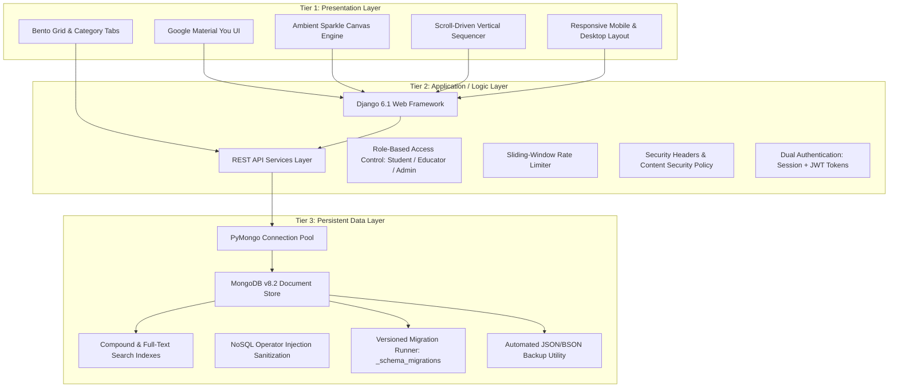

# 🌐 LearnSphere: Student Innovation & Smart Education Platform

<div align="center">


<br/>

> **“Student Innovation &ndash; Smart education, a concept that describes learning in digital age. It enables learners to learn more effectively, efficiently, flexibly and comfortably.”**

</div>

---

## 📖 Table of Contents
1. [Core Vision & Design Language](#-core-vision--design-language)
2. [3-Tier Enterprise Architecture](#-3-tier-enterprise-architecture)
3. [Student Workspace & Innovation Features](#-student-workspace--innovation-features)
4. [Educator & Mentor Studio](#-educator--mentor-studio)
5. [Digital Library & Bookshelf](#-digital-library--bookshelf)
6. [Security, Authentication & RBAC](#-security-authentication--rbac)
7. [MongoDB Versioned Migration Engine & Backups](#-mongodb-versioned-migration-engine--backups)
8. [Quickstart & Windows Launcher](#-quickstart--windows-launcher)
9. [Pre-Seeded Test Credentials](#-pre-seeded-test-credentials)
10. [REST API Documentation](#-rest-api-documentation)

---

## 🎯 Core Vision & Design Language

**LearnSphere** is an enterprise-grade Smart Education and Student Innovation platform engineered to elevate digital learning. Inspired by the human-centered product showcase aesthetic of **Google Books (`googlebook.google`)** and **Google Chromebooks (`chromebook.google`)**, LearnSphere provides:

- **Material Design 3 / Google Product Palette**: High-contrast light surfaces, soft rounded cards (`border-radius: 24px`), pill-shaped CTAs, and Google's signature color accents:
  - 🔵 **Effectively** &mdash; Google Blue (`#1a73e8`)
  - 🟢 **Efficiently** &mdash; Google Green (`#1e8e3e`)
  - 🟡 **Flexibly** &mdash; Google Amber (`#b06000`)
  - 🟣 **Comfortably** &mdash; Google Purple (`#9334e6`)
- **Ambient Sparkle Particle Canvas**: Interactive 4-point sparkle stars with physics-based cursor repulsion, accessible navbar toggle, and strict `@media (prefers-reduced-motion: reduce)` compliance.
- **Scroll-Driven Vertical Sequencer**: `IntersectionObserver`-powered narrative on the left that transitions sticky preview panels on the right.
- **Accessible Multi-Column Bento Grid**: Information architecture detailing platform pillars, adaptive curricula, and student achievements.
- **Interactive Domain Switcher**: Accessible tabbed interface seamlessly toggling between Smart Courses, AI Study Tools, Digital Library, and Educator Studio.

---

## 🏗️ 3-Tier Enterprise Architecture

LearnSphere strictly enforces separation of concerns across three distinct layers:



### Detailed Layer Breakdown:
- **Tier 1 (Presentation Tier)**:
  - Lightweight, dependency-free vanilla CSS and modern JavaScript (Zero heavy external frontend frameworks).
  - Fluid typography (`clamp()`), glassmorphic navigation with Google 4-color dot identity, and accessible looping demo controls.
- **Tier 2 (Application & Logic Tier)**:
  - Decoupled business services (`AuthService`, `ResourceService`, `InnovationService`, `CourseService`) completely isolated from HTTP requests and database drivers.
  - Strict input validation, PBKDF2 password hashing with salt, and sliding-window rate limiting.
- **Tier 3 (Persistent Data Tier)**:
  - MongoDB 8.2 with high-performance connection pooling (`maxPoolSize=200`, `minPoolSize=20`, `waitQueueTimeoutMS=5000`).
  - Compound indexes (`{"category": 1, "created_at": -1}`) and text search indexes across academic curricula and student innovations.

---

## 🎓 Student Workspace & Innovation Features

Designed to give students the agency to explore, prototype, and build tangible software solutions:

1. **Student Innovation Hub**:
   - Publish digital learning prototypes with title, category, abstract, and tech stack tags.
   - Attach external GitHub repositories and live demonstration URLs.
   - Atomic community upvoting and collaborative peer-review discussion threads.
2. **Cognitive Study Streak & Milestone Tracker**:
   - 7-Day Consistency Study Streak counter with milestone badges.
   - Weekly Focus Hours progress tracker (e.g., 14.5 hrs / 20 hrs target).
   - Real-time cognitive retention metric (+4.5% retention gain indicator).
3. **Daily Cognitive Micro-Quiz**:
   - Interactive daily recall challenge with instant client-side answer validation.
   - Rewards learners with experience points (XP) for mastering core principles.
4. **Adaptive Curriculum Progression**:
   - Enrolled tracks with chapter checkpoints and cognitive difficulty adjustment.
   - Quick one-click enrollment into personalized course recommendations.

---

## 👨‍🏫 Educator & Mentor Studio

Empowering educators to guide the next generation of digital learners:

1. **Student Innovation Review Queue**:
   - Centralized inbox of student prototype submissions across the platform.
   - Review project abstracts, inspect GitHub code repositories, and verify live demos.
2. **Verified Mentor Endorsement Badges**:
   - Award official **"Mentor Endorsed"** accreditation badges directly to outstanding student projects.
   - Structured inline mentorship feedback to assist students in iterating on their solutions.
3. **Curriculum & Lesson Authoring**:
   - Modular course creation tools allowing educators to structure units, reading materials, and difficulty levels.
4. **Cohort Mastery Telemetry**:
   - View active enrolled student counts, completion percentages, and cohort retention statistics.
   - One-click export for student progress analytics reports.

---

## 📚 Digital Library & Bookshelf

Inspired by **Google Books**, the curated digital study library offers:

- **Academic Textbooks & Research**: Curated foundational texts from MIT Press, Oxford University Press, Cambridge, and O'Reilly Media.
- **Search-as-you-Type & Filtering**: Instant search across titles, descriptions, and categories (Adaptive Learning, Computer Science, Cognitive Ergonomics).
- **Personal Study Bookshelf**: One-click bookmarking to save key references directly to the student dashboard.
- **Markdown Outlines & Code Previews**: Interactive syntax-highlighted code blocks and mathematical formulations embedded in textbook details.

---

## 🛡️ Security, Authentication & RBAC

| Security Layer | Implementation Detail |
| :--- | :--- |
| **Password Storage** | PBKDF2 algorithm with SHA-256 hash and 260,000 iterations + cryptographic salt |
| **Dual Auth Context** | Seamless session cookies for web views + Bearer JWT tokens for REST API clients |
| **RBAC Roles** | Role hierarchy (`student`, `educator`, `admin`) enforced via `@role_required_mongo` view decorators |
| **NoSQL Sanitization** | `BaseRepository.sanitize_query()` strips dangerous MongoDB operators (`$where`, `$regex`, `$ne`, `$gt`) from untrusted inputs |
| **Rate Limiting** | Sliding window rate limiter enforcing a 1,000 req/min cap per client IP with `429 Too Many Requests` handling |
| **Security Headers** | Enforces `Content-Security-Policy`, `X-Content-Type-Options: nosniff`, and `X-Frame-Options: SAMEORIGIN` |

---

## 🗄️ MongoDB Versioned Migration Engine & Backups

Database schema evolution and disaster recovery are automated and version-controlled:

### Versioned Migrations:
- **`0001_initial_schema_and_indexes.py`**: Initializes collections (`users`, `resources`, `projects`, `courses`, `benchmarks`) and creates compound, text, and unique indexes.
- **`0002_seed_initial_data.py`**: Seeds pre-configured student, educator, and admin accounts, 8 academic textbooks, 3 smart education courses, and 2 innovation projects.
- Run migrations:
  ```powershell
  .venv\Scripts\python.exe database/migrations/migration_runner.py
  ```

### Automated Backup & Restore:
```powershell
# Create automated timestamped JSON backup
.venv\Scripts\python.exe scripts/backup_mongodb.py backup

# Restore database from backup archive
.venv\Scripts\python.exe scripts/backup_mongodb.py restore backups/backup_20261123_202029.json
```

---

## 🚀 Quickstart & Windows Launcher

### Prerequisites:
- Python 3.12+
- MongoDB v8.2+ installed and running on `localhost:27017`

### 1-Click Launchers (Windows):
Double-click `start.bat` or run in PowerShell:
```powershell
.\start.ps1
```

### Manual Setup:
```powershell
# 1. Activate virtual environment
.venv\Scripts\Activate.ps1

# 2. Install dependencies
pip install -r requirements.txt

# 3. Execute MongoDB migrations
python database/migrations/migration_runner.py

# 4. Run Django development server
python manage.py runserver 127.0.0.1:8000
```
Open your browser to: **`http://127.0.0.1:8000/`**

---

## 🔑 Pre-Seeded Test Credentials

| Role | Username | Email | Password | Access Capabilities |
| :--- | :--- | :--- | :--- | :--- |
| **Student** | `student` | `student@learnsphere.io` | `Student@LearnSphere2026!` | Enrolled tracks, submit projects, daily quiz, saved bookshelf |
| **Educator** | `mentor` | `mentor@learnsphere.io` | `Mentor@LearnSphere2026!` | Review queue, award mentor badges, author curricula, class analytics |
| **Admin** | `admin` | `admin@learnsphere.io` | `Admin@LearnSphere2026!` | Complete administrative access, system telemetry, and user management |

---

## 📡 REST API Documentation

### Authentication APIs:
- `POST /auth/api/login/` &mdash; Authenticate with email/username and password. Returns JWT token and user profile.
- `POST /auth/api/register/` &mdash; Register new student or educator account with PBKDF2 hashing.
- `GET /auth/api/me/` &mdash; Get current authenticated user profile and enrollment list.

### Digital Resources & Courses:
- `GET /resources/api/` &mdash; Filter and search academic textbooks with category and tag filters.
- `POST /resources/api/<id>/bookmark/` &mdash; Toggle bookmark on a digital book.
- `GET /courses/api/` &mdash; Retrieve available smart education tracks.
- `POST /courses/api/<id>/enroll/` &mdash; Enroll current authenticated user in track.

### Student Innovation Hub:
- `GET /innovation/api/` &mdash; Paginated list of student innovation projects.
- `POST /innovation/api/submit/` &mdash; Submit a student innovation prototype.
- `POST /innovation/api/<id>/upvote/` &mdash; Atomic community upvoting.
- `POST /innovation/api/<id>/comment/` &mdash; Post peer feedback and discussion.

---

## 💻 Repository Structure

```
LearnSphere/
├── apps/                        # Tier 2 Application Modules
│   ├── analytics/               # Home, dashboard & metrics
│   ├── authentication/          # User registration, login, JWT
│   ├── courses/                 # Smart education tracks & enrollment
│   ├── innovation/              # Student innovation hub & upvoting
│   └── resources/               # Google Books digital library
├── core/                        # Middleware, permissions & utils
│   ├── middleware.py            # Security headers & rate limiter
│   ├── permissions.py           # RBAC decorators
│   └── utils.py                 # API responses & helpers
├── database/                    # Tier 3 Persistent Data Tier
│   ├── connection.py            # PyMongo singleton connection pool
│   ├── migrations/              # Versioned migration files
│   └── repositories/            # Data access object repositories
├── learnsphere/                 # Django project configuration
│   ├── settings.py              # Environment configuration & middleware
│   └── urls.py                  # Root route orchestration
├── scripts/                     # Operational automation scripts
│   ├── backup_mongodb.py        # Automated JSON backup & restore
│   └── verify_system.py         # End-to-end integration test suite
├── static/                      # Static assets
│   ├── css/main.css             # Material Design 3 design system
│   └── js/app.js                # Ambient sparkle canvas & tab switcher
├── templates/                   # Tier 1 Presentation Templates
│   ├── base.html                # Base layout with ambient canvas
│   ├── components/              # Navbar, footer, modal drawers
│   └── pages/                   # Home, courses, innovation, library, dashboard
├── manage.py                    # Django CLI entrypoint
├── requirements.txt             # Python project dependencies
├── start.bat                    # Windows batch launcher
├── start.ps1                    # PowerShell launcher
└── README.md                    # Platform documentation
```

---

<div align="center">
  <b>LearnSphere &copy; 2026</b> &bull; Built for Student Innovation & Smart Education
</div>
