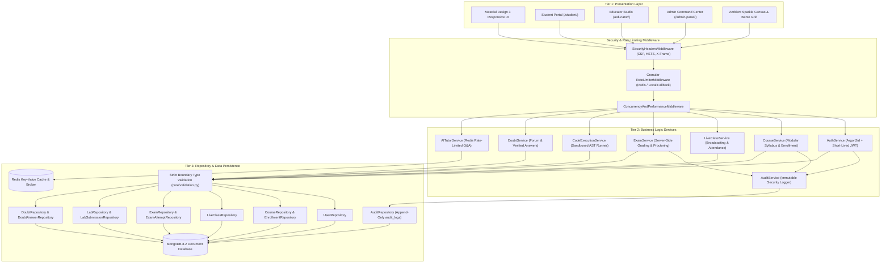

# 🌐 LearnSphere: Full-Stack Smart Education & Student Innovation Platform

<div align="center">


<br/>

> **“Student Innovation &ndash; Smart education, a concept that describes learning in digital age. It enables learners to learn more effectively, efficiently, flexibly and comfortably.”**

</div>

---

## 📖 Table of Contents
1. [Platform Vision & Aesthetic](#-platform-vision--aesthetic)
2. [3-Tier Architecture & System Flow](#-3-tier-architecture--system-flow)
3. [5-Role Role-Based Access Control (RBAC)](#-5-role-role-based-access-control-rbac)
4. [3-Tier Dedicated Portals](#-3-tier-dedicated-portals)
5. [Core Learning Engines (Phases 0–7)](#-core-learning-engines-phases-07)
   - [Phase 0: Security, RBAC & Immutable Audit Log](#phase-0-security-rbac--immutable-audit-log)
   - [Phase 1: Course & Dynamic Syllabus Engine](#phase-1-course--dynamic-syllabus-engine)
   - [Phase 2: Live Classes & Master Timetable](#phase-2-live-classes--master-timetable)
   - [Phase 3: Quizzes & Proctored Exams](#phase-3-quizzes--proctored-exams)
   - [Phase 4: Hands-on Virtual Labs & Sandboxed Code Runner](#phase-4-hands-on-virtual-labs--sandboxed-code-runner)
   - [Phase 5: Doubt Solving & AI Tutor Companion](#phase-5-doubt-solving--ai-tutor-companion)
   - [Phase 6: Dedicated Portals, Streaks & Certificates](#phase-6-dedicated-portals-streaks--certificates)
   - [Phase 7: End-to-End Test Suite & Verification](#phase-7-end-to-end-test-suite--verification)
6. [Enterprise Security & Token Lifecycle](#-enterprise-security--token-lifecycle)
7. [Disaster Recovery & Extended JSON Backups](#-disaster-recovery--extended-json-backups)
8. [Docker Compose & Deployment](#-docker-compose--deployment)
9. [Quickstart & Initial Admin Bootstrap](#-quickstart--initial-admin-bootstrap)
10. [Automated Test Suite (38 Passing Tests)](#-automated-test-suite-38-passing-tests)
11. [REST API & OpenAPI Specification](#-rest-api--openapi-specification)

---

## 🎯 Platform Vision & Aesthetic

**LearnSphere** is an enterprise-grade Smart Education and Student Innovation platform modeled after the pedagogical depths of Coursera, PhysicsWallah, and Udemy, combined with Google's human-centered showcase aesthetic:

- **Material Design 3 Palette & Surfaces**: High-contrast surfaces, generous whitespace, soft rounded cards (`border-radius: 24px`), pill-shaped CTAs, and 4 core learning pillars:
  - 🔵 **Effectively** &mdash; Blue (`#1a73e8`): Cognitive mastery-driven modular curriculum.
  - 🟢 **Efficiently** &mdash; Green (`#1e8e3e`): Frictionless interactive video lessons & labs.
  - 🟡 **Flexibly** &mdash; Amber (`#b06000`): Self-paced tracks with responsive device synchronization.
  - 🟣 **Comfortably** &mdash; Purple (`#9334e6`): Ergonomic typography, contrast balance, and reduced fatigue.
- **Ambient Sparkle Particle Canvas**: Interactive 4-point sparkle canvas with physics-based cursor repulsion, navbar toggle, and `@media (prefers-reduced-motion: reduce)` accessibility.
- **Scroll-Driven Vertical Sequencer**: `IntersectionObserver`-powered narrative on the left that transitions sticky preview panels on the right.
- **Accessible Multi-Column Bento Grid**: Information architecture detailing platform pillars, adaptive curricula, and student achievements.
- **Interactive Domain Switcher**: Accessible tabbed interface seamlessly toggling between Smart Courses, Live Lectures, Virtual Labs, Proctored Exams, and Doubt Discussions.

---

## 🏗️ 3-Tier Architecture & System Flow

LearnSphere enforces strict separation of concerns across three distinct layers:



---

## 🛡️ 5-Role Role-Based Access Control (RBAC)

The platform enforces a five-tier authorization hierarchy across distinct portals:

| Role | Target Portal | Primary Permissions & Responsibilities |
| :--- | :--- | :--- |
| **`super_admin`** | `/admin-panel/` | Global platform administration, system settings, RBAC role assignment, immutable audit log inspection, all permissions (`*`). |
| **`dept_admin`** | `/admin-panel/` | Departmental course approval, educator oversight, batch student enrollment imports, academic report exports. |
| **`moderator`** | `/admin-panel/` | Discussion forum moderation, student innovation project review, dispute handling. |
| **`educator`** | `/educator/` | Course authoring, syllabus composition, live class streaming, quiz/exam creation, grade override, verified answer marking. |
| **`student`** | `/student/` | Course enrollment, video streaming, taking quizzes and proctored exams, lab participation, doubt asking, certificate earning. |

> **Security Note**: Public registration is strictly restricted to the `student` role. Educator account signups enter an administrative approval queue (`is_approved=False`) and cannot access educator tooling until approved.

---

## 🖥️ 3-Tier Dedicated Portals

### 1. Student Portal (`/student/`)
- **Dashboard**: Real-time learning telemetry calculated from genuine database events (active consecutive day streak, study hours, completed lessons, certificates earned).
- **Daily Concept Quiz**: Interactive question with answer keys kept strictly server-side. Evaluates student responses and awards 50 XP once per calendar day.
- **Verified Completion Certificate**: High-resolution, printable Certificate of Completion unlocked once course progress achieves 100%.
- **Live Classroom Launcher**: Instant access to ongoing and scheduled live broadcasts.

### 2. Educator Operations Studio (`/educator/`)
- **Curriculum Authoring**: Multi-tier course authoring with modular syllabi, video lessons, and preview controls.
- **Broadcast Console**: Live lecture scheduler and host launcher with in-stream doubt flags and hand-raise rosters.
- **Proctoring Submissions Audit**: Student exam submissions list highlighting anti-cheat tab-switch anomalies.
- **Faculty Grade Override**: Authorized grade revision interface with mandatory justification reason recorded in immutable audit logs.

### 3. Administrative Command Center (`/admin-panel/`)
- **Platform Telemetry**: Real-time counters for total accounts, published curricula, enrollments, exams, and doubts.
- **5-Role User Management**: Directory with role filter, search, and hierarchical role assignment controls.
- **Educator Approval Queue**: One-click review, approval, or rejection of pending educator registrations.
- **Curriculum Approval Workflow**: Review and publication approvals for draft and submitted courses.
- **Immutable Audit Log Explorer**: Read-only query table inspecting chronological security logs (timestamp, actor, action, resource, IP, status).

---

## ⚡ Core Learning Engines (Phases 0–7)

### Phase 0: Security, RBAC & Immutable Audit Log
- **Argon2id Hasher**: Tunable memory-hardness protecting credentials against GPU brute-force attacks.
- **Account Lockout**: 5 failed consecutive login attempts automatically locks the account for 15 minutes.
- **JWT Lifecycle**: 15-minute access token with cryptographic `jti` and 7-day rotating refresh token with server-side revocation list.
- **Strict Boundary Validation**: `core/validation.py` schema validators strictly reject untrusted types and NoSQL operators (`$where`, `$regex`, `$gt`).
- **Append-Only Audit Log**: `audit_logs` collection overrides and strictly blocks update and delete mutations.

### Phase 1: Course & Dynamic Syllabus Engine
- **Modular Syllabi**: Dynamic modules containing structured video, reading, and lab lessons.
- **Preview Controls**: Free preview lessons viewable by any user; enrolled lessons protected by authentication.
- **Telemetry Progress**: Real-time recalculation of completion percentage upon finishing each lesson topic.
- **Player Interface**: Ergonomic video lesson player with playback speeds, table of contents, and sequential navigation.

### Phase 2: Live Classes & Master Timetable
- **Live Broadcasts**: Scheduled lectures with WebRTC/HLS room IDs and lifecycle transitions (`scheduled` &rarr; `live` &rarr; `completed`).
- **In-Stream Discussions**: Real-time chat with dedicated question doubt flags.
- **Active Hand Raises**: Attendee hand-raising mechanism allowing educators to prioritize student inquiries.
- **Weekly Master Timetable**: Comprehensive weekly timetable filterable by date and course track.

### Phase 3: Quizzes & Proctored Exams
- **Anti-Leak Answer Protection**: Answer keys and explanations are completely stripped from student taker payloads.
- **Server-Side Grading**: Submission scoring and passing criteria (60% threshold) computed exclusively on the server.
- **Anti-Cheat Proctoring**: Real-time telemetry monitoring `visibilitychange` and window blur events. Attempts exceeding tab switch limits are automatically flagged.
- **Faculty Grade Overrides**: Educators can override disputed grades with mandatory audit logging.

### Phase 4: Hands-on Virtual Labs & Sandboxed Code Runner
- **AST Security Filtering**: Inspects Python Abstract Syntax Trees prior to execution, blocking forbidden imports (`os`, `subprocess`, `sys`, `socket`) and dangerous builtins (`eval`, `exec`, `open`).
- **Subprocess Isolation**: Student scripts run with isolated stdout capture, execution time measurement (ms), and timeout limits.
- **Automated Test Runner**: Executes assertion unit tests against student algorithms to calculate passing scores.

### Phase 5: Doubt Solving & AI Tutor Companion
- **Peer & Faculty Forums**: Academic inquiries with markdown support, tags, and course linkage.
- **Atomic Upvoting**: Strict set-based deduplication (`$addToSet` / `$pull`) ensuring one vote per user per doubt.
- **Verified Solutions**: Original author or faculty can accept solutions, marking threads resolved.
- **AI Tutor Companion**: Adaptive study assistant synthesizing smart education concepts with a daily quota rate-limiter (50 queries/day per user via Redis).

### Phase 6: Dedicated Portals, Streaks & Certificates
- **Real-Event Streaks**: Calculated from actual database events (completed lessons, lab submissions, exam attempts, logins) rather than hardcoded metrics.
- **Daily Quiz Engine**: Curated smart education questions awarding XP once per calendar day.
- **Official Certificates**: Verified completion certificate with unique cryptographic ID and LearnSphere seal for 100% finished tracks.

### Phase 7: End-to-End Test Suite & Verification
- **Automated Integration**: Full lifecycle test suite `tests/test_phase7_e2e_integration.py` verifying registration, authentication, enrollment, live sessions, proctored exams, virtual labs, doubts, AI tutor, and admin governance.

---

## 🔐 Enterprise Security & Token Lifecycle

| Security Dimension | Technical Implementation |
| :--- | :--- |
| **Password Hashing** | Modern **Argon2id** hasher with PBKDF2 compatibility and modern Django password validators. |
| **Account Lockout** | After **5 consecutive failed attempts** within 15 minutes, the account is locked for **15 minutes**. |
| **Access Tokens** | Short-lived **15-minute** JWT access token issued with unique cryptographic `jti`. |
| **Refresh Tokens** | **7-day** rotating refresh token. Old refresh token is revoked on every rotation and tracked in Redis/Cache. |
| **Cookie Hardening** | `HttpOnly`, `SameSite=Lax`, and `Secure` (production/HTTPS) flags for authentication tokens. |
| **Rate Limiting** | Redis-backed sliding window limiter: Login/Register: 5 req/min; AI Tutor: 50 req/day; API: 120 req/min; Web: 300 req/min. |
| **Proxy Handling** | `X-Forwarded-For` is only accepted from configured `TRUSTED_PROXIES`. |
| **Boundary Validation** | `core/validation.py` strictly validates primitive types and rejects raw NoSQL operators (`$where`, `$regex`, `$gt`). |

---

## 🗄️ Disaster Recovery & Extended JSON Backups

- Uses **MongoDB Canonical Extended JSON** (`bson.json_util`), preserving BSON types (`ObjectId`, `ISODate`).
- **Integrity Checksums**: Generates SHA-256 hashes for all exported collections.
- **Restore Verification Mode**:
  ```powershell
  # Create timestamped backup
  python scripts/backup_mongodb.py --action backup --path backups/

  # Verify backup archive integrity without modifying active database
  python scripts/backup_mongodb.py --action restore --path backups/ --verify

  # Full database restore
  python scripts/backup_mongodb.py --action restore --path backups/
  ```

---

## 🐳 Docker Compose & Deployment

LearnSphere includes a production-grade multi-container stack:
```bash
# Start all services (Django, MongoDB, Redis, Celery, MinIO)
docker compose up -d

# Inspect running services
docker compose ps

# Run database migrations inside container
docker compose exec web python database/migrations/migration_runner.py
```

### ▲ Deploy to Vercel (Serverless WSGI)
1. Import this GitHub repository into [Vercel](https://vercel.com/).
2. Vercel automatically detects `vercel.json` and routes requests to `learnsphere/wsgi.py` (`app`) with WhiteNoise static asset serving (`WHITENOISE_USE_FINDERS=True`).
3. Configure the following Environment Variables in **Vercel Project Settings &rarr; Environment Variables**:
   - `DEBUG=False`
   - `SECRET_KEY=<strong-random-secret>`
   - `JWT_SECRET=<strong-32+-char-jwt-secret>`
   - `MONGODB_URI=mongodb+srv://<user>:<password>@<cluster>.mongodb.net/?retryWrites=true&w=majority`
   - `MONGODB_NAME=learnsphere_db`
   - `REDIS_URL=<optional-upstash-redis-url>`
4. Deploy — static files, signed-cookie sessions, and MongoDB Atlas pooling work out of the box.

---

## 🚀 Quickstart & Initial Admin Bootstrap

### 1. Prerequisites:
- Python 3.12+
- MongoDB v8.2+ running on `localhost:27017`

### 2. Setup Virtual Environment:
```powershell
python -m venv .venv
.\.venv\Scripts\Activate.ps1
pip install -r requirements.txt
```

### 3. Bootstrap Super Administrator Account:
To prevent publishing plaintext passwords in source control, initialize the administrator account using the management command:
```powershell
# Automatically generates a high-entropy password and outputs to console once:
python manage.py bootstrap_admin --email admin@learnsphere.io

# Or specify custom credentials via environment:
python manage.py bootstrap_admin --email admin@learnsphere.io --password "YourStrongPassword2026!"
```

### 4. Seed Demo Curricula & Modules:
```powershell
python database/migrations/migration_runner.py
```

### 5. Launch Development Server:
```powershell
python manage.py runserver 127.0.0.1:8000
```
Open your browser to: **`http://127.0.0.1:8000/`**

---

## 🧪 Automated Test Suite (38 Passing Tests)

Run the automated test suite across all 9 phases (Phases 0–8):
```powershell
pytest tests/ -v
```

```text
tests/test_phase0_security_rbac.py::test_rbac_matrix_and_hierarchy PASSED
tests/test_phase0_security_rbac.py::test_boundary_schema_validation PASSED
tests/test_phase0_security_rbac.py::test_public_registration_role_lockdown PASSED
tests/test_phase0_security_rbac.py::test_account_lockout_after_failed_attempts PASSED
tests/test_phase0_security_rbac.py::test_jwt_short_lived_access_and_rotation PASSED
tests/test_phase0_security_rbac.py::test_immutable_audit_log PASSED
tests/test_phase1_course_syllabus.py::test_course_creation_and_syllabus_authoring PASSED
tests/test_phase1_course_syllabus.py::test_lesson_access_preview_vs_enrolled PASSED
tests/test_phase1_course_syllabus.py::test_student_progress_and_completion PASSED
tests/test_phase1_course_syllabus.py::test_prev_next_lesson_navigation PASSED
tests/test_phase2_live_classes.py::test_schedule_live_class PASSED
tests/test_phase2_live_classes.py::test_stream_lifecycle_status_transitions PASSED
tests/test_phase2_live_classes.py::test_live_chat_and_doubt_questions PASSED
tests/test_phase2_live_classes.py::test_hand_raise_interaction PASSED
tests/test_phase3_exams.py::test_exam_creation_and_taker_payload_sanitization PASSED
tests/test_phase3_exams.py::test_server_side_grading_and_evaluation PASSED
tests/test_phase3_exams.py::test_anti_cheat_proctor_flagging PASSED
tests/test_phase3_exams.py::test_faculty_grade_override_and_audit_trail PASSED
tests/test_phase3_exams.py::test_exam_take_view_renders_cleanly_for_student PASSED
tests/test_phase4_labs.py::test_code_runner_safe_execution PASSED
tests/test_phase4_labs.py::test_code_sandbox_security_rejections PASSED
tests/test_phase4_labs.py::test_lab_test_case_evaluation PASSED
tests/test_phase5_doubts_ai.py::test_ask_doubt_and_post_answers PASSED
tests/test_phase5_doubts_ai.py::test_accept_solution_resolution PASSED
tests/test_phase5_doubts_ai.py::test_atomic_upvoting PASSED
tests/test_phase5_doubts_ai.py::test_ai_tutor_synthesis_and_quota_limits PASSED
tests/test_phase6_portals.py::test_real_event_metrics_and_streak_calculation PASSED
tests/test_phase6_portals.py::test_server_side_daily_quiz_xp_security PASSED
tests/test_phase6_portals.py::test_student_certificate_eligibility PASSED
tests/test_phase6_portals.py::test_portal_rbac_authorization PASSED
tests/test_phase6_portals.py::test_educator_grade_override_and_audit PASSED
tests/test_phase6_portals.py::test_admin_educator_approval_queue PASSED
tests/test_phase7_e2e_integration.py::test_complete_platform_e2e_workflow PASSED
tests/test_phase8_educator_platform.py::test_educator_can_update_course PASSED
tests/test_phase8_educator_platform.py::test_educator_can_see_students_progress PASSED
tests/test_phase8_educator_platform.py::test_educator_can_schedule_exam PASSED
tests/test_phase8_educator_platform.py::test_educator_can_see_results_and_override_grade PASSED
tests/test_phase8_educator_platform.py::test_educator_report_and_admin_workflow PASSED

======================= 38 passed, 6 warnings in 11.06s =======================
```

### Phase 8: Educator Operations & Admin Reporting
- **Course Curriculum Editor (`/courses/educator/<course_id>/edit/`)**: Full metadata & module/lesson editor with Draft, Publish, and Submit-to-Admin workflows.
- **Cohort & Student Progress Analytics (`/educator/students-progress/`)**: Real-time completion percentages, completed lesson counts, and search/course filters.
- **Exam Scheduler (`/exams/educator/create/`)**: Timed proctored exam scheduling with start/end windows, tab-switch limits, and interactive question authoring.
- **Results & Grade Overrides (`/educator/exams/submissions/`)**: Inspect student scores, anti-cheat telemetry, and override grades with mandatory audit justification.
- **Educator-to-Admin Reporting (`/educator/reports/submit/` -> `/admin-panel/reports/<report_id>/acknowledge/`)**: Escalate proctoring incidents, progress summaries, or curriculum updates directly to the Admin Command Center.

---

## 📡 REST API & OpenAPI Specification

- OpenAPI schema endpoint: `GET /api/schema/`
- Interactive Swagger UI: `GET /api/docs/`

### Core Authentication Endpoints:
- `POST /auth/api/login/` &mdash; Authenticates credentials, returns 15m access token + 7d rotating refresh token.
- `POST /auth/api/token/refresh/` &mdash; Rotates refresh token, invalidating old token and returning new pair.
- `POST /auth/api/logout/` &mdash; Revokes active refresh token and clears session cookies.
- `POST /auth/api/register/` &mdash; Public registration (enforces student role; educator signups enter review queue).
- `GET /auth/api/me/` &mdash; Current user profile, role, and enrollment state.

---

<div align="center">
  <b>LearnSphere &copy; 2026</b> &bull; Built for Student Innovation & Smart Education
</div>
