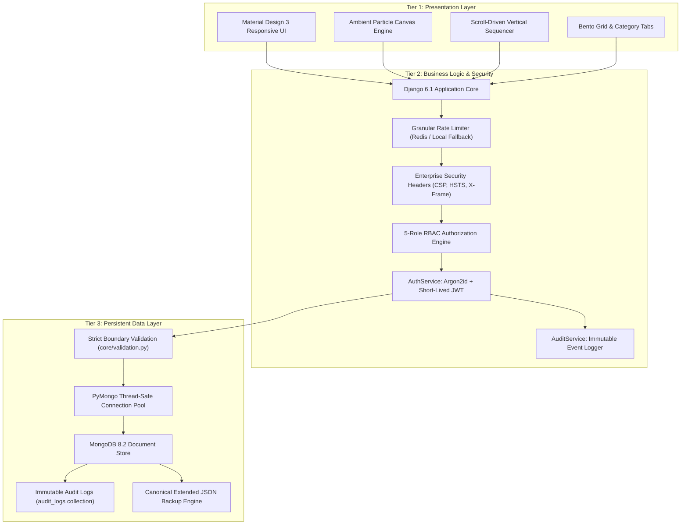

# 🌐 LearnSphere: Smart Education & Student Innovation Platform

<div align="center">


<br/>

> **“Student Innovation &ndash; Smart education, a concept that describes learning in digital age. It enables learners to learn more effectively, efficiently, flexibly and comfortably.”**

</div>

---

## 📖 Table of Contents
1. [Core Vision & Design Language](#-core-vision--design-language)
2. [3-Tier Architecture & System Flow](#-3-tier-architecture--system-flow)
3. [5-Role Role-Based Access Control (RBAC)](#-5-role-role-based-access-control-rbac)
4. [Enterprise Security & Token Lifecycle](#-enterprise-security--token-lifecycle)
5. [Immutable Audit Logging](#-immutable-audit-logging)
6. [Student Workspace & Innovation Features](#-student-workspace--innovation-features)
7. [Educator Studio & Course Authoring](#-educator-studio--course-authoring)
8. [Digital Library & Bookshelf](#-digital-library--bookshelf)
9. [Disaster Recovery & Extended JSON Backups](#-disaster-recovery--extended-json-backups)
10. [Docker Compose & Deployment](#-docker-compose--deployment)
11. [Quickstart & Initial Admin Bootstrap](#-quickstart--initial-admin-bootstrap)
12. [REST API & OpenAPI Specification](#-rest-api--openapi-specification)

---

## 🎯 Core Vision & Design Language

**LearnSphere** is an enterprise-grade Smart Education and Student Innovation platform engineered to elevate digital learning. Inspired by the human-centered product showcase aesthetic of modern digital platforms, LearnSphere delivers:

- **Material Design 3 Palette & Surfaces**: High-contrast surfaces, soft rounded cards (`border-radius: 24px`), pill-shaped CTAs, and 4 core learning pillars:
  - 🔵 **Effectively** &mdash; Blue (`#1a73e8`): Cognitive mastery-driven modular curriculum.
  - 🟢 **Efficiently** &mdash; Green (`#1e8e3e`): Frictionless interactive video lessons & labs.
  - 🟡 **Flexibly** &mdash; Amber (`#b06000`): Self-paced tracks with responsive device synchronization.
  - 🟣 **Comfortably** &mdash; Purple (`#9334e6`): Ergonomic typography, contrast balance, and reduced fatigue.
- **Ambient Sparkle Particle Canvas**: Interactive 4-point sparkle canvas with physics-based cursor repulsion, navbar toggle, and `@media (prefers-reduced-motion: reduce)` compliance.
- **Scroll-Driven Vertical Sequencer**: `IntersectionObserver`-powered narrative on the left that transitions sticky preview panels on the right.
- **Accessible Multi-Column Bento Grid**: Information architecture detailing platform pillars, adaptive curricula, and student achievements.
- **Interactive Domain Switcher**: Accessible tabbed interface seamlessly toggling between Smart Courses, AI Study Tools, Digital Library, and Educator Studio.

---

## 🏗️ 3-Tier Architecture & System Flow

LearnSphere enforces strict separation of concerns across three distinct layers:



### Layer Breakdown:
- **Tier 1 (Presentation Tier)**:
  - Dependency-free vanilla CSS and modern JavaScript with zero heavy external UI frameworks.
  - Fluid typography (`clamp()`), glassmorphic navigation, and accessible media controls.
- **Tier 2 (Application & Logic Tier)**:
  - Decoupled business services (`AuthService`, `CourseService`, `AuditService`, `ResourceService`, `InnovationService`) completely isolated from HTTP requests and database drivers.
  - Strict boundary input validation, Argon2id password hashing, rotating refresh tokens, and Redis-backed rate limiting.
- **Tier 3 (Persistent Data Tier)**:
  - MongoDB 8.2 with connection pooling (`maxPoolSize=20` dev, configurable for high concurrency in production).
  - Compound indexes (`{"category": 1, "created_at": -1}`) and text search indexes across academic curricula and student innovations.

---

## 🛡️ 5-Role Role-Based Access Control (RBAC)

The platform enforces a five-tier authorization hierarchy across distinct portals:

| Role | Target Portal | Primary Permissions & Responsibilities |
| :--- | :--- | :--- |
| **`super_admin`** | `/admin-panel/` | Global platform administration, system settings, RBAC role assignment, immutable audit log inspection, all permissions (`*`). |
| **`dept_admin`** | `/admin-panel/` | Departmental course approval, educator oversight, batch student enrollment imports, academic report exports. |
| **`moderator`** | `/admin-panel/` | Discussion forum moderation, student innovation project review, dispute handling. |
| **`educator`** | `/educator/` | Course authoring, syllabus composition, live class streaming, quiz/exam creation, grade management, prototype endorsements. |
| **`student`** | `/student/` | Course enrollment, video streaming, taking quizzes and proctored exams, lab participation, project submission, upvoting. |

> **Security Note**: Public registration is strictly restricted to the `student` role. Educator account signups enter an administrative approval queue (`is_approved=False`) and cannot access educator tooling until approved.

---

## 🔐 Enterprise Security & Token Lifecycle

| Security Dimension | Technical Implementation |
| :--- | :--- |
| **Password Hashing** | Modern **Argon2id** hasher with PBKDF2 compatibility and modern Django password validators. |
| **Account Lockout** | After **5 consecutive failed attempts** within 15 minutes, the account is locked for **15 minutes**. |
| **Access Tokens** | Short-lived **15-minute** JWT access token issued with unique cryptographic `jti`. |
| **Refresh Tokens** | **7-day** rotating refresh token. Old refresh token is revoked on every rotation and tracked in Redis/Cache. |
| **Cookie Hardening** | `HttpOnly`, `SameSite=Lax`, and `Secure` (production/HTTPS) flags for authentication tokens. |
| **Rate Limiting** | Redis-backed sliding window limiter: Login/Register: 5 req/min; AI Tutor: 50 req/day; API: 120 req/min; Web: 300 req/min. |
| **Proxy Handling** | `X-Forwarded-For` is only accepted from configured `TRUSTED_PROXIES`. |
| **Boundary Validation** | `core/validation.py` strictly validates primitive types and rejects raw NoSQL operators (`$where`, `$regex`, `$gt`). |

---

## 📜 Immutable Audit Logging

All security-sensitive operations are captured in an append-only `audit_logs` collection:
- Authentication successes, failures, and account lockouts.
- Role modifications and educator account approvals.
- Grade overrides with educator ID and justification rationale.
- Proctored exam violations and browser switch events.

The repository layer strictly overrides and blocks `update_one` and `delete_one`, raising `NotImplementedError` if mutation is attempted.

---

## 🎓 Student Workspace & Innovation Features

1. **Student Innovation Hub**:
   - Publish digital learning prototypes with title, category, abstract, and tech stack tags.
   - Attach external GitHub repositories and live demonstration URLs.
   - Atomic community upvoting and collaborative peer-review discussion threads.
2. **Cognitive Study Streak & Milestone Tracker**:
   - 7-Day Consistency Study Streak counter with milestone badges.
   - Weekly Focus Hours progress tracker (e.g., 14.5 hrs / 20 hrs target).
   - Real-time cognitive retention metric (+4.5% retention gain indicator).
3. **Daily Cognitive Micro-Quiz**:
   - Server-validated daily recall challenge awarding XP once per question per day.
4. **Adaptive Curriculum Progression**:
   - Enrolled tracks with chapter checkpoints and difficulty adjustment.

---

## 👨‍🏫 Educator Studio & Course Authoring

1. **Curriculum & Lesson Authoring**:
   - Modular course creation tools allowing educators to structure units, reading materials, and difficulty levels.
2. **Student Innovation Review Queue**:
   - Centralized inbox of student prototype submissions across the platform.
3. **Verified Mentor Endorsement Badges**:
   - Award official **"Mentor Endorsed"** accreditation badges directly to outstanding student projects.
4. **Cohort Telemetry & Gradebook**:
   - View active enrolled student counts, completion percentages, and cohort retention statistics.

---

## 📚 Digital Library & Bookshelf

- **Academic Textbooks & Research**: Curated foundational texts from MIT Press, Oxford University Press, Cambridge, and O'Reilly Media.
- **Search-as-you-Type & Filtering**: Instant search across titles, descriptions, and categories.
- **Personal Study Bookshelf**: One-click bookmarking to save key references directly to the student dashboard.
- **Markdown Outlines & Code Previews**: Interactive syntax-highlighted code blocks and mathematical formulations.

---

## 🗄️ Disaster Recovery & Extended JSON Backups

- Uses **MongoDB Canonical Extended JSON** (`bson.json_util`), preserving BSON types (`ObjectId`, `ISODate`).
- **Integrity Checksums**: Generates SHA-256 hashes for all exported collections.
- **Restore Verification Mode**:
  ```powershell
  # Create timestamped backup
  python scripts/backup_mongodb.py --action backup --path backups/

  # Verify backup archive integrity without modifying active database
  python scripts/backup_mongodb.py --action restore --path backups/ --verify

  # Full database restore
  python scripts/backup_mongodb.py --action restore --path backups/
  ```

---

## 🐳 Docker Compose & Deployment

LearnSphere includes a production-grade multi-container stack:
```bash
# Start all services (Django, MongoDB, Redis, Celery, MinIO)
docker compose up -d

# Inspect running services
docker compose ps

# Run database migrations inside container
docker compose exec web python database/migrations/migration_runner.py
```

---

## 🚀 Quickstart & Initial Admin Bootstrap

### 1. Prerequisites:
- Python 3.12+
- MongoDB v8.2+ running on `localhost:27017`

### 2. Setup Virtual Environment:
```powershell
python -m venv .venv
.\.venv\Scripts\Activate.ps1
pip install -r requirements.txt
```

### 3. Bootstrap Super Administrator Account:
To prevent publishing plaintext passwords in source control, initialize the administrator account using the management command:
```powershell
# Automatically generates a high-entropy password and outputs to console once
python manage.py bootstrap_admin --email admin@learnsphere.io

# Or specify custom credentials:
python manage.py bootstrap_admin --email admin@learnsphere.io --password "YourStrongPassword2026!"
```

### 4. Seed Demo Curricula & Textbooks:
```powershell
# Migrations seed demo textbooks, courses, and student innovations:
python database/migrations/migration_runner.py
```

### 5. Launch Development Server:
```powershell
python manage.py runserver 127.0.0.1:8000
```
Open your browser to: **`http://127.0.0.1:8000/`**

---

## 📡 REST API & OpenAPI Specification

- OpenAPI schema endpoint: `GET /api/schema/`
- Interactive Swagger UI: `GET /api/docs/`

### Core Authentication Endpoints:
- `POST /auth/api/login/` &mdash; Authenticates credentials, returns 15m access token + 7d rotating refresh token.
- `POST /auth/api/token/refresh/` &mdash; Rotates refresh token, invalidating old token and returning new pair.
- `POST /auth/api/logout/` &mdash; Revokes active refresh token and clears session cookies.
- `POST /auth/api/register/` &mdash; Public registration (enforces student role; educator signups enter review queue).
- `GET /auth/api/me/` &mdash; Current user profile, role, and enrollment state.

---

<div align="center">
  <b>LearnSphere &copy; 2026</b> &bull; Built for Student Innovation & Smart Education
</div>
